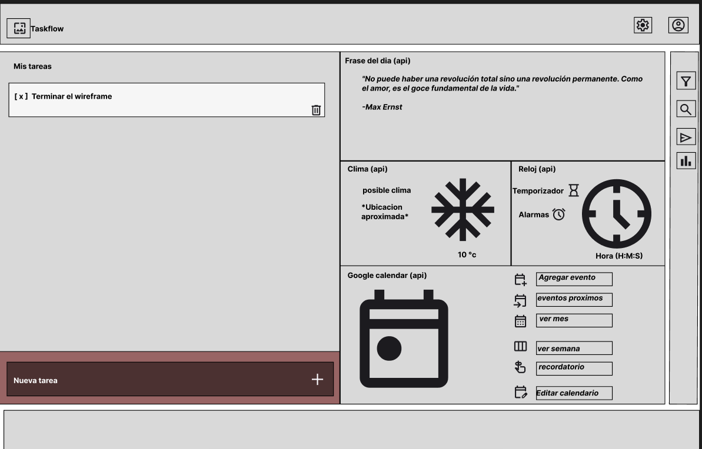

# TaskFlow

TaskFlow es mucho más que un planificador de tareas: es **el** planificador de tareas. Integra en un solo lugar varias herramientas de productividad:

- Ver el clima en tiempo real.
- Reloj con temporizador y alarmas.
- Integración con Google Calendar.
- Frase motivacional diaria.
- Crear, gestionar, editar y eliminar tareas por categorías.

TaskFlow busca ser la "navaja suiza" de la productividad, útil para desarrolladores de software y para cualquier persona que quiera tener control de sus tareas con múltiples herramientas en un solo lugar.

No pierdas la oportunidad de ponerle orden a tu vida con TaskFlow.

## Cómo ejecutar el proyecto localmente

1. Clona o descarga el repositorio.
2. Abre la carpeta del proyecto.
3. Abre `index.html` en tu navegador (doble clic) o usa un servidor local, por ejemplo:
   - VS Code: extensión "Live Server".
   - Python: `python -m http.server 8000` y visita `http://localhost:8000`.
4. Para probar el login, abre `HTML/Account.html`.

No requiere instalación de dependencias: Bootstrap se carga por CDN.

## Estructura del proyecto

```
TaskFlow/
├── index.html
├── README.md
├── CSS/
│   └── style.css
├── js/
│   ├── index.js         # Formulario, APIs y eventos de las tarjetas
│   └── taskManager.js   # Clase TaskManager: alta, baja, guardado y render
├── HTML/
│   └── Account.html     # Pantalla de inicio de sesión (estilo Windows 98)
├── assets/
│   ├── logo.png
│   ├── Taskflow.png
│   └── wireframe.png
├── sprint#1/            # Guías PDF de las tareas 1 a 3
├── sprint#2/            # Guías PDF de las tareas 4 a 6
└── sprint#3/            # Guía PDF de la tarea 7
```

Las guías de los sprints se conservan únicamente en formato PDF dentro de las carpetas `sprint#1/`, `sprint#2/` y `sprint#3/`.

## Wireframe

Vista del wireframe en Figma para referencia del HTML:



## Herramientas y recursos

- Trello: https://trello.com/b/NyN3cwda/personal-project-generation
- Figma: https://www.figma.com/design/gwwLYaZRAwn027K6FYgYbU/Taskflow-planificador-de-tareas?node-id=0-1&t=M2keFS30TokYQRMB-1

## APIs

- Calendario: FullCalendar (open source) + eventos en localStorage
- Reloj: hora local del navegador (`toLocaleTimeString`), sin API externa
- Weather: https://open-meteo.com/
- Frase del día: lista local en español (sin API externa)

## Demo (GitHub Pages)

Proyecto publicado: https://maurux01.github.io/TaskFlow/

## Cumplimiento del Sprint 1

### Tarea 1 — Implementación del Wireframe con Bootstrap
- Estructura principal de la página con header, main y footer.
- Formulario para registrar tareas (nombre, descripción/contenido, estado, fecha).
- Espacio destinado a la lista de tareas (`#taskList`).
- Componentes implementados con Bootstrap (CDN) y CSS propio.
- Proyecto almacenado en repositorio de GitHub.

### Tarea 2 — Tarjeta de Tarea y Lista de Tareas
- Componente visual de tarjeta (`task-card` con clases Bootstrap `card`).
- Cada tarjeta muestra: nombre, descripción, fecha de entrega y estado (badge).
- Contenedor `#taskList` para visualizar las tareas.
- Cinco tarjetas de ejemplo con información diferente.
- Interfaz organizada y consistente con el wireframe.

### Tarea 3 — Validación de Entradas del Formulario
- Archivo `js/index.js` creado e incluido correctamente en `index.html`.
- Función `validFormFieldInput(data)` implementada.
- Campos recuperados mediante `document.querySelector` y `.value`.
- Uso de `console.log` para verificar los datos ingresados.
- Validaciones: nombre no vacío, descripción no vacía, estado con opción seleccionada, fecha válida.
- Componente Alert de Bootstrap que se muestra con datos inválidos y se oculta con datos válidos.
- Botón "Cancelar" limpia los campos y cierra el formulario.
- Pruebas manuales: formulario vacío, campos incompletos y formulario válido.

### Cierre del Sprint 1
- Repositorio actualizado.
- Archivo `README.md` presente con descripción, Trello, Figma y demo.
- Proyecto publicado en GitHub Pages (enlace arriba).

## Cumplimiento del Sprint 2

### Tarea 4 — Clase de Tareas y marcado de completado
- Carpeta `js/` organizada con `index.js` (formulario, APIs y eventos) y `taskManager.js` (clase TaskManager).
- Clase `TaskManager` creada en `js/taskManager.js` con `this.tasks = []`.
- Scripts vinculados en `index.html` en el orden correcto (`taskManager.js` antes de `index.js`).
- Instancia `taskManager` creada y verificada desde la consola (`[]`).
- La funcionalidad de marcar como completada se conserva: en la Tarea 7 quedó unificada en el botón **Mark As Done** (`done-button`), con cambio visual (tachado, color y borde). El toggle **Completar/Pendiente** se retiró por redundante; para volver a `Pendiente` se usa el `<select>` de estado.
- Cambios guardados en el repositorio.

### Tarea 5 — Agregar tareas de manera programada
- El constructor de `TaskManager` acepta `currentId = 0` y expone `this.currentId`.
- Método `addTask(name, description, dueDate, status)` que incrementa el contador y hace `push()` de la nueva tarea en `this.tasks`.
- Cada tarea recibe un `id` consecutivo y `PORHACER` como estado inicial por defecto.
- El formulario "Nueva tarea" escucha `submit`, aplica `event.preventDefault()` y la validación existente antes de registrar la tarea.
- Después de registrar, el formulario queda limpio y listo para otra entrada.

### Tarea 6 — Eliminar una tarea
- Cada tarjeta incluye el botón **Delete** con la clase `delete-button` (además de las clases de estilo del proyecto).
- `TaskManager.deleteTask(taskId)` construye `newTasks`, conserva solo las tareas cuyo `id` es diferente y actualiza `this.tasks`.
- El `EventListener` de `click` sobre `#taskList` detecta `delete-button`, obtiene el contenedor con `data-task-id`, convierte el id con `Number()` y ejecuta `deleteTask()` → `save()` → `render()`.
- Las tareas se guardan en `localStorage` (`taskFlowTasks`); al recargar, la tarea eliminada no vuelve a aparecer.
- Las tarjetas de ejemplo del HTML se convierten en tareas del `TaskManager` la primera vez, para que también puedan eliminarse y persistir.
- Métodos `save()`, `load()` y `render()` centralizan persistencia y dibujado de la lista.

### Cierre del Sprint 2
- El repositorio conserva los avances de las Tareas 4, 5 y 6 y del Sprint 1.
- El historial de commits registra la evolución del sprint (no solo el resultado final).
- La aplicación permite crear, marcar como completada, cambiar el estado y eliminar tareas.
- La eliminación y los cambios de estado permanecen al recargar la página.
- Deploy actualizado con la versión final del Sprint 2 y enlace verificado desde este README.
- Guías de entrega conservadas en PDF en `sprint#1/` y `sprint#2/`.

## Cumplimiento del Sprint 3

### Tarea 7 — Actualizar una tarea
- Cada tarjeta (la estática del HTML y la generada por `createTaskHtml`) incluye el botón **Mark As Done** con la clase `done-button`.
- La lista `#taskList` usa un único EventListener de `click`; con `event.target`/`closest` localiza `parentTask`, la tarjeta sobre la que se hizo clic.
- El contenedor de la tarea expone `data-task-id` (en el HTML y mediante `card.dataset.taskId`), y `render()` pasa `task.id` a `createTaskHtml(id, name, description, dueDate, status)`.
- `TaskManager.getTaskById(taskId)` recorre `this.tasks` con `for...of`, guarda la coincidencia en `foundTask` y la devuelve.
- El valor de `data-task-id` se convierte con `Number()` antes de buscar la tarea.
- La tarea seleccionada cambia su `status` a `'DONE'` y se vuelve a renderizar con `taskManager.render()`.
- Se eliminó el botón toggle **Completar/Pendiente**: **Mark As Done** es el único control para marcar una tarea como hecha.
- El `<select>` ya no permite elegir `DONE` ni `Completada`: sus opciones son `Pendiente`, `En progreso` e `Importante`. Cuando la tarea está en `DONE` aparece una opción `DONE` deshabilitada y seleccionada que solo refleja el estado. Para volver a `Pendiente` se cambia el `<select>`.
- Las tareas guardadas con el estado heredado `Completada` se normalizan a `DONE` al cargar, para que no queden estados duplicados.
- El checkbox de la tarjeta quedó como indicador visual (`disabled`) y ya no dispara cambios de estado.
- Estilos: `Mark As Done` en verde y `Delete` en rojo, ambos con bisel Win98 explícito (claro arriba/izquierda, oscuro abajo/derecha) y estados hover/active.
- El selector de estado usa chips con contraste alto sobre el gris: `Pendiente` gris claro con texto oscuro, `En progreso` azul marino con texto blanco, `Importante` ámbar con texto oscuro y `DONE` verde con texto blanco. La flecha del `<select>` cambia a blanca en los fondos oscuros.
- Se conservan el historial de commits y las funcionalidades de los sprints anteriores: formulario y validación, cambio de estado, eliminar, reloj, clima, frase y calendario.
- `api.js` quedó integrado en `js/index.js` para respetar la estructura base del PDF (`js/index.js` + `js/taskManager.js`), sin perder ninguna integración previa.

> **Nota:** la Tarea 8 del Sprint 3 (persistencia de tareas en LocalStorage como nueva actividad) no se ha adelantado. El guardado en `localStorage` que ya existe corresponde a los avances de los sprints anteriores y se mantuvo intacto.

### Cierre del Sprint 3
- Guía de entrega de la Tarea 7 conservada en PDF en `sprint#3/`.
- Cambios listos para ser guardados mediante commits en el mismo repositorio.

## Créditos

Hecho en su totalidad por Mauro Infante — Maurux01.

Este proyecto fue creado gracias al apoyo del bootcamp Generation Colombia. ¡Muchas gracias!

Copyright (c) 2026 Author. All Rights Reserved.
