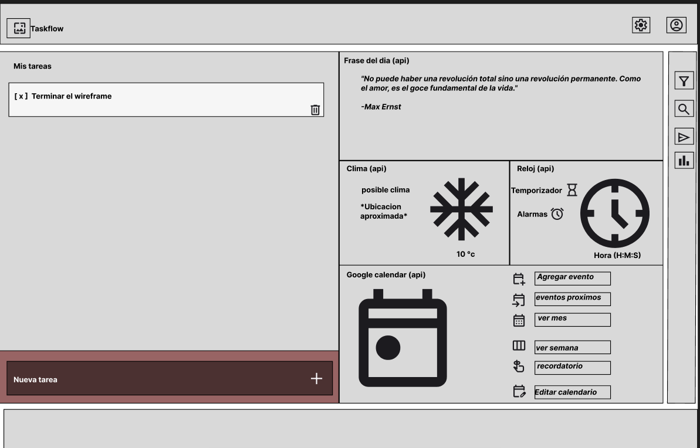

# TaskFlow

TaskFlow es mucho más que un planificador de tareas: es **el** planificador de tareas. Integra en un solo lugar varias herramientas de productividad:

- Ver el clima en tiempo real.
- Reloj con temporizador y alarmas.
- Integración con Google Calendar.
- Frase motivacional diaria.
- Crear, gestionar, editar y eliminar tareas por categorías.

TaskFlow busca ser la "navaja suiza" de la productividad, útil para desarrolladores de software y para cualquier persona que quiera tener control de sus tareas con múltiples herramientas en un solo lugar.

No pierdas la oportunidad de ponerle orden a tu vida con TaskFlow.

## Cómo ejecutar el proyecto localmente

1. Clona o descarga el repositorio.
2. Abre la carpeta del proyecto.
3. Abre `index.html` en tu navegador (doble clic) o usa un servidor local, por ejemplo:
   - VS Code: extensión "Live Server".
   - Python: `python -m http.server 8000` y visita `http://localhost:8000`.
4. Para probar el login, abre `HTML/Account.html`.

No requiere instalación de dependencias: Bootstrap se carga por CDN.

## Estructura del proyecto

```
TaskFlow/
├── index.html
├── README.md
├── CSS/
│   └── style.css
├── JS/
│   └── app.js          # Validación del formulario de tareas
├── HTML/
│   └── Account.html    # Pantalla de inicio de sesión (estilo Windows 98)
└── assets/
    ├── logo.png
    ├── wireframe.png
    └── Taskflow.png
```

## Wireframe

Vista del wireframe en Figma para referencia del HTML:



## Herramientas y recursos

- Trello: https://trello.com/b/NyN3cwda/personal-project-generation
- Figma: https://www.figma.com/design/gwwLYaZRAwn027K6FYgYbU/Taskflow-planificador-de-tareas?node-id=0-1&t=M2keFS30TokYQRMB-1

## APIs

- Calendar: https://developers.google.com/workspace/calendar/api/guides/overview?hl=es-419
- Time: https://time.now/developer/api
- Weather: https://open-meteo.com/
- Frase del día: https://frasedeldia.azurewebsites.net/api/phrase

## Demo (GitHub Pages)

Proyecto publicado: https://maurux01.github.io/TaskFlow/

## Cumplimiento del Sprint 1

### Tarea 1 — Implementación del Wireframe con Bootstrap
- Estructura principal de la página con header, main y footer.
- Formulario para registrar tareas (nombre, descripción/contenido, estado, fecha).
- Espacio destinado a la lista de tareas (`#taskList`).
- Componentes implementados con Bootstrap (CDN) y CSS propio.
- Proyecto almacenado en repositorio de GitHub.

### Tarea 2 — Tarjeta de Tarea y Lista de Tareas
- Componente visual de tarjeta (`task-card` con clases Bootstrap `card`).
- Cada tarjeta muestra: nombre, descripción, fecha de entrega y estado (badge).
- Contenedor `#taskList` para visualizar las tareas.
- Cinco tarjetas de ejemplo con información diferente.
- Interfaz organizada y consistente con el wireframe.

### Tarea 3 — Validación de Entradas del Formulario
- Archivo `JS/app.js` creado e incluido correctamente en `index.html`.
- Función `validFormFieldInput(data)` implementada.
- Campos recuperados mediante `document.querySelector` y `.value`.
- Uso de `console.log` para verificar los datos ingresados.
- Validaciones: nombre no vacío, descripción no vacía, estado con opción seleccionada, fecha válida.
- Componente Alert de Bootstrap que se muestra con datos inválidos y se oculta con datos válidos.
- Botón "Cancelar" limpia los campos y cierra el formulario.
- Pruebas manuales: formulario vacío, campos incompletos y formulario válido.

### Cierre del Sprint 1
- Repositorio actualizado.
- Archivo `README.md` presente con descripción, Trello, Figma y demo.
- Proyecto publicado en GitHub Pages (enlace arriba).

## Cumplimiento del Sprint 2

### Tarea 4 — Clase de Tareas y marcado de completado
- Carpeta `js/` organizada con `index.js` y `taskManager.js`.
- Clase `TaskManager` creada en `js/taskManager.js` con `this.tasks = []`.
- Scripts vinculados en `index.html` en el orden correcto (`taskManager.js` antes de `index.js`).
- Instancia `taskManager` creada y verificada desde la consola (`[]`).
- Botón **✔ Completar / ↺ Pendiente** en cada tarjeta para marcar y desmarcar una tarea como completada (toggle) sin recargar la página, con cambio visual (tachado, color y borde).
- Cambios guardados en el repositorio.

## Créditos

Hecho en su totalidad por Mauro Infante — Maurux01.

Este proyecto fue creado gracias al apoyo del bootcamp Generation Colombia. ¡Muchas gracias!

Copyright (c) 2026 Author. All Rights Reserved.